


# astril: Automated Segmentation Toolkit for Radiology Image Libraries
### Authors:
- Alexander Ling (alexander.l.ling@gmail.com; alling@bwh.harvard.edu)
-  E. Antonio Chiocca
### License: Creative Commons CC BY-NC-SA 4.0
### License Holders:
- Alexander Ling
- E. Antonio Chiocca
- Mass General Brigham
### Installation Requirements:
- Python 3.11
### Description:
astril is a python package designed to streamline radiology image pre-processing (i.e. scan type identification, DICOM to NIFTI conversion, co-registration, skull stripping, normalization, etc.), segmentation, and model training. The package was built to make it easy for other researchers to trivially apply our glioblastoma segmentation algorithms to their own brain MRI scans while also providing the tools to refine our models or train their own from scratch. Most of the functions in this package should also work with radiology images other than MRIs, though the functionality and models are currently tailred specifically to MRI images.

A detailed description of the package and instructions for its use will be provided in the coming months as we finalize the package and its associated manuscript.

### Default 2.5-D training architecture

New training configurations use `residual_context_unext_25d`. The model keeps
Astril's center-slice 2.5-D workflow while adding an ordered-slab 3-D context
stem, a 2-D GroupNorm residual encoder/decoder, identity-initialized residual
skip attention, native half/quarter-resolution deep supervision, and explicit
modality-presence inputs. The generated defaults use seven input slices, two
blocks per level, two dilated bottleneck blocks, EMA validation/checkpoint
weights, and category-controlled optional-modality dropout:

```ini
architecture_type = residual_context_unext_25d
num_input_slices = 7
base_num_filters = 32
encoder_level_factors = 1,2,4,8
center_depth = 2
blocks_per_level = 2
skip_attention_type = residual
use_modality_presence_encoding = true
use_deep_supervision = true
deep_supervision_weights = 0.25,0.125
channel_dropout_strategy = subset
channel_dropout_subset_probabilities = full:0.50,single:0.25,double:0.15,required_only:0.10
use_ema = true
ema_decay = 0.999
```

Legacy `dynamic_attention_resunet` and migrated TensorFlow checkpoints remain
loadable. New multi-plane segmentation configurations default to
`average_logit`; optional `merging_weights` can assign one non-negative weight
to each axial, coronal, or sagittal model.

### General Workflow (rough draft)
---
For the current DICOM preprocessing API, metadata-indexed workflow, function
inputs/outputs, and organization-index schema, see
[the preprocessing reference](docs/preprocessing_reference.md).

#### Format for radiology image inputs:
astril is designed to perform image pre-processing and segmentation on NIFTI (.nii.gz) images. However, astril includes functionality to convert DICOM imaging datasets to NIFTI images and organize them into the folder structure expected by astril's processing functions.

If starting from a set of DICOM images, **no particular folder structure is required.** DICOM files can be nested in any arrangement (including mixed layouts across patients and files without a .dcm extension). astril identifies patients, exams, and series from the DICOM metadata (PatientID, StudyInstanceUID, and SeriesInstanceUID) rather than from folder names.

If starting from a set of NIFTI images, they should be organized by patient, exam, and sequence as in the following example:
```
NIFTI_Library/
├── Patient1/ 					{Patient}
|   ├── Exam1/ 				    {Exam}
|	|	├── T1n.nii.gz 			{Sequence}
|	|	├── T1c.nii.gz 
|	|	├── ...			
|   ├── ...
├── ...
```
---
#### Convert DICOM library to NIFTI library
The DICOM to NIFTI workflow is:
```
DICOM library (any structure)
  └─ organize_dicoms ─────────────────► Organized DICOM library + DICOM index
       └─ create_patient_metadata ────► Patient metadata table   (you fill in patientID and day0Date)
            └─ plan_dicom_to_nifti_conversion ─► Conversion plan  (you review/edit)
                 └─ convert_dicom_plan ────────► NIFTI library
```
The organized library and the DICOM index produced in step 1 are used by both step 2 and step 3. See [the preprocessing reference](docs/preprocessing_reference.md) for the full Python API and the DICOM index schema.

1. Organize the DICOM library. This reads the metadata of every file under --dir (recursively) and copies each readable DICOM file into a normalized `Patient/Exam/Series` tree under --outDir. It also writes a DICOM index (one row per file) that the later steps use to find patients, exams, and series. The original library is not modified.
    ```
    usage: python -m astril.preprocess organize_dicoms [-h] --dir DIR --outDir OUTDIR --indexOut INDEXOUT [--quarantineDir QUARANTINEDIR] [--logOut LOGOUT] [--unresolvedOut UNRESOLVEDOUT] [--dryRun]
                                                       [--n_workers N_WORKERS] [--noProgress]

    options:
      -h, --help            show this help message and exit
      --dir DIR             Source directory; source folder names are ignored for identity (default: None)
      --outDir OUTDIR       Normalized output directory (default: None)
      --indexOut INDEXOUT   Output index (.csv|.tsv) (default: None)
      --quarantineDir QUARANTINEDIR
                            Directory for files missing or conflicting required metadata (default: None)
      --logOut LOGOUT       Optional copy of the complete organizer index (default: None)
      --unresolvedOut UNRESOLVEDOUT
                            Optional unresolved-file report (.csv|.tsv); defaults beside the index (default: None)
      --dryRun              Read and index metadata without copying files (default: False)
      --n_workers N_WORKERS
                            Threads for metadata reads and copies (default: None)
      --noProgress          Disable progress bar (default: False)
    ```
    The organized library will look like this (the exact folder labels are generated from metadata; the index is the authoritative mapping back to the original files):
    ```
    Organized_DICOM/
    ├── Patient_<PatientID>_<hash>/
    |   ├── Exam_<StudyInstanceUID hash>/
    |   |   ├── Series_<SeriesNumber>_<SeriesDescription>_<hash>/
    |   |   |   ├── <DICOM files>
    |   |   ├── ...
    |   ├── ...
    ├── _quarantine/
    ├── ...
    ```
    - The index must be a .csv or .tsv file.
    - Files that are unreadable, missing required identity metadata, or whose UIDs conflict with other files are copied to `_quarantine/` (or --quarantineDir) instead of the organized tree. These files, and any other files that were not organized cleanly, are listed in an unresolved-file report written next to the index as `<index name>_unresolved.csv`. Review this report after organizing.
    - Because series are separated by SeriesInstanceUID, this step also separates DICOM files from different series that were stored in the same folder. The older `demix_dicoms` command is not needed for this workflow (see [the preprocessing reference](docs/preprocessing_reference.md)).
    - **The organized folder names include the DICOM PatientID, which may be PHI.** The NIFTI library created in step 4 uses the patient IDs you assign in step 2 instead.

2. Create a spreadsheet of patient-level metadata to help with organizing/deidentifying your dataset during NIFTI file conversion. Run this on the organized library from step 1 and pass the DICOM index with --index.
    ```
    usage: python -m astril.preprocess create_patient_metadata [-h] --dir DIR --metadataOut METADATAOUT [--previousMetadata [PREVIOUSMETADATA ...]] [--omitPrevious] [--subdirs SUBDIRS [SUBDIRS ...]]
                                                               [--index INDEX] [--excludeEmpty] [--n_workers N_WORKERS]

    options:
      -h, --help            show this help message and exit
      --dir DIR             Root directory with {Patient}/.../MR/{series} (default: None)
      --metadataOut METADATAOUT
                            Output table (.csv|.tsv|.xlsx) (default: None)
      --previousMetadata [PREVIOUSMETADATA ...]
                            Zero or more prior tables to prefill from (default: [])
      --omitPrevious        Omit rows already present in previous tables (default: False)
      --subdirs SUBDIRS [SUBDIRS ...]
                            Subfolder names to search under each patient folder (default: ['MR'])
      --index INDEX         Optional organize_dicoms() index; derive patient rows from DICOM metadata (default: None)
      --excludeEmpty        Drop patient folders with no DICOM series found (default: False)
      --n_workers N_WORKERS
                            Threads for scanning (I/O bound). Set 1 to disable. (default: None)
    ```
    When --index is supplied, --dir should be the organized library from step 1, and --subdirs is not used. This will generate a metadata table with the following columns:
    - **Directory:** The patient folder in the organized library (relative to --dir) to which the metadata in a given row pertains.
    - **patientID:** An arbitrary identifier that you will assign to this patient. This is the identifier that will be used when DICOM files are converted to NIFTI files.
    - **patientName:** The name of the patient as extracted from the DICOM metadata. If more than one name occurs in a patient folder, they are listed together separated by `; `.
    - **dicomPatientID:** The patientID for this patient as extracted from the DICOM metadata.
    - **day0Date:** A date (mm/dd/yyyy) that should be used as day 0 when organizing scans by timepoint.

    You must fill in **patientID** and **day0Date** before the next step. Rows missing either value are skipped during conversion planning.

    <u>Example of an Incomplete Table</u>
    |Directory|patientID|patientName|dicomPatientID|day0Date|
     |-|-|-|-|-|
     |Patient_1234567_3f9a1c2b7d| |jane doe|1234567||
     |Patient_7654321_a81e04c6f2| |john doe|7654321||

    <u>Example of a Completed Table</u>
    |Directory|patientID|patientName|dicomPatientID|day0Date|
     |-|-|-|-|-|
     |Patient_1234567_3f9a1c2b7d|Subject1|jane doe|1234567|01/21/1900|
     |Patient_7654321_a81e04c6f2|Subject2|john doe|7654321|01/22/1900|

     Note: If you load the patient metadata table into Excel to edit it, **do not** permit excel to perform data conversion. Data conversion can alter values in the Directory column (for example, by removing leading 0's), causing the directories listed in the table to no longer match the actual directory names.

 3. Create a DICOM to NIFTI conversion plan by identifying DICOM series types and identifying where the converted scans will be stored and how they will be named. --dir must be the organized library from step 1, and --dicomIndex must be the index from step 1.
     ```
     usage: python -m astril.preprocess plan_dicom_to_nifti_conversion [-h] --patientMetadata PATIENTMETADATA --dir DIR --dicomIndex DICOMINDEX --outDir OUTDIR --planOut PLANOUT [--n_workers N_WORKERS]
                                                                       [--noProgress] [--previousPlan [PREVIOUSPLAN ...]] [--ignorePrevious] [--minSlices MINSLICES] [--use_actual_exam_ids]
                                                                       [--add_missing_derived] [--make_derived_from_scratch] [--unexpectedMultiframePolicy {keep_first,skip}]

    options:
      -h, --help            show this help message and exit
      --patientMetadata PATIENTMETADATA
                            Table from create_patient_metadata() (filled in) (default: None)
      --dir DIR             Root DICOM directory; must contain subfolders in 'Directory' column (default: None)
      --dicomIndex DICOMINDEX
                            CSV/TSV index produced by organize_dicoms() (default: None)
      --outDir OUTDIR       Planned destination root for converted files (default: None)
      --planOut PLANOUT     Where to write the plan (.csv|.tsv) (default: None)
      --n_workers N_WORKERS
                            Threads per exam (I/O bound) (default: None)
      --noProgress          Disable progress bar (default: False)
      --previousPlan [PREVIOUSPLAN ...]
                            0+ previous plan files to reuse/skip exam directories from. (default: None)
      --ignorePrevious      Skip exams already present in previous plan files (instead of reusing their rows). (default: False)
      --minSlices MINSLICES
                            Minimum slices required to consider a sequence for selection. (default: 10)
      --use_actual_exam_ids
                            Use the terminal ExamDirectory folder name as ExamAlias (may contain PHI) instead of a random 8-char alias. (default: False)
      --add_missing_derived
                            Identify derived scan types missing for each primary in an exam and add DERIVE jobs to the plan. (default: False)
      --make_derived_from_scratch
                            Ignore existing derived scans and plan DERIVE jobs for all supported derived types from primaries. (default: False)
      --unexpectedMultiframePolicy {keep_first,skip}
                            What to do if a sequence expected to be single-frame/3D converts to multi-frame/4D. keep_first = keep frame 0 (warn); skip = skip conversion (warn). (default: keep_first)
    ```
    This will generate a table which lists all of the scan series in the organized library along with the patient, timepoint, and inferred scan type (i.e. T1c, T1n, etc.) associated with them. After this file has been created, **manually inspect and edit it** to ensure that all desired series will be converted and correctly named in the next step. The columns relevant to conversion in the next step are:
    - selected_for_conversion
    - proposed_nifti_path

    All scans selected for conversion with a valid proposed_nifti_path will be converted to that path. The proposed file names are constructed to follow the format `{outDir}/{patientID}/{patientID}_{timepoint_days}_{ExamAlias}/{patientID}_{timepoint_days}_{final_label}.nii.gz`. This is the format astril will expect NIFTI libraries to be in for downstream segmentation/algorithm training.

4. Convert DICOM image library to a NIFTI image library. The plan is the only required input; it already records where each series is stored in the organized library.
    ```
    usage: python -m astril.preprocess convert_dicom_plan [-h] --plan PLAN [--n_workers N_WORKERS] [--overwrite] [--logOut LOGOUT] [--unexpectedMultiframePolicy {keep_first,skip}] [--debug]

    options:
      -h, --help            show this help message and exit
      --plan PLAN           Path to plan CSV/TSV/XLSX from plan_dicom_to_nifti_conversion. (default: None)
      --n_workers N_WORKERS
                            Parallel workers (I/O-bound). (default: None)
      --overwrite           Overwrite existing output NIfTI if present. (default: False)
      --logOut LOGOUT       Optional CSV/TSV log path for results. (default: None)
      --unexpectedMultiframePolicy {keep_first,skip}
                            What to do if a sequence expected to be single-frame/3D converts to multi-frame/4D. keep_first = keep frame 0 (warn); skip = skip conversion (warn). (default: keep_first)
      --debug               Print debug statements. (default: False)
    ```

    This will use the conversion plan created in the last step to actually convert the files to a NIFTI library, ready for downstream processing and segmentation.

Example command sequence (PowerShell):
```powershell
python -m astril.preprocess organize_dicoms `
  --dir D:\DICOM_Library `
  --outDir D:\Organized_DICOM `
  --indexOut D:\Organized_DICOM\dicom_index.csv

python -m astril.preprocess create_patient_metadata `
  --dir D:\Organized_DICOM `
  --index D:\Organized_DICOM\dicom_index.csv `
  --metadataOut D:\Organized_DICOM\patient_metadata.csv

# Fill in patientID and day0Date in patient_metadata.csv, then:
python -m astril.preprocess plan_dicom_to_nifti_conversion `
  --patientMetadata D:\Organized_DICOM\patient_metadata.csv `
  --dir D:\Organized_DICOM `
  --dicomIndex D:\Organized_DICOM\dicom_index.csv `
  --outDir D:\NIFTI_Library `
  --planOut D:\Organized_DICOM\conversion_plan.csv

# Review selected_for_conversion and proposed_nifti_path in conversion_plan.csv, then:
python -m astril.preprocess convert_dicom_plan `
  --plan D:\Organized_DICOM\conversion_plan.csv
```
---
#### Perform image pre-processing on NIFTI library
Currently, the only preprocessing pipeline implemetned in astril is for brain MRI exams. This pipeline co-registers all identified MRI series for a given patient to a common reference series, resamples to a common data shape, skull-strips, and normalizes. The resulting pre-processed output folder should be fully de-identified (no guarantee -- you are responsible for verifying this to ensure no PHI is leaked) and fully ready for use with segmentation pipelines.

The preprocesing pipline can be applied by simply applying the following function to the NIFTI library generated in the previous step. Note that you will need to run "pip install astril[preprocessing]" the before the first time running preprocessing pipelines in astril.
```
usage: python -m astril.preprocess_brain_mris [-h] --in_dir IN_DIR --out_dir OUT_DIR [--preprocess_log PREPROCESS_LOG] [--coreg_log COREG_LOG] [--old_coreg_log [OLD_COREG_LOG ...]] [--dont_coregister]
                                              [--n_workers N_WORKERS] [--n_workers_per_registration_process N_WORKERS_PER_REGISTRATION_PROCESS] [--n_workers_per_hd_bet_process N_WORKERS_PER_HD_BET_PROCESS]
                                              [--overwrite] [--no_reuse_patient_brainmask] [--modalities MODALITIES] [--anchor_label ANCHOR_LABEL] [--registration_metric REGISTRATION_METRIC]
                                              [--registration_strategy REGISTRATION_STRATEGY] [--family_parent_map FAMILY_PARENT_MAP] [--final_dims NX NY NZ] [--final_voxels SX SY SZ]
                                              [--save_scans_with_skulls] [--use_gpu] [--enable_tta] [--skip_qc] [--debug] [--verbose]

Batch brain MRI preprocessing over a NIFTI library (patient/exam tree).

options:
  -h, --help            show this help message and exit
  --in_dir IN_DIR       Path to NIFTI library root (converted by convert_dicom_plan).
  --out_dir OUT_DIR     Path to write preprocessed outputs (patient/exam structure).
  --preprocess_log PREPROCESS_LOG
                        CSV/TSV path for per-exam outcomes. Auto-generated if omitted.
  --coreg_log COREG_LOG
                        CSV path for chosen per-patient reference. Auto-generated if omitted.
  --old_coreg_log [OLD_COREG_LOG ...]
                        One or more prior coreg logs to reuse references.
  --dont_coregister     Disable co-registration; run each exam independently.
  --n_workers N_WORKERS
                        Parallel workers across patients (threaded). Use 1 to run serially.
  --n_workers_per_registration_process N_WORKERS_PER_REGISTRATION_PROCESS
                        Optional override: CPU threads to allow per SimpleITK/ITK process within each pipeline. Default: floor(cpu_threads / n_workers).
  --n_workers_per_hd_bet_process N_WORKERS_PER_HD_BET_PROCESS
                        Optional override: CPU threads to allow for HD-BET when device=cpu, per pipeline. Default: min(8, floor(cpu_threads / n_workers)). (Capped at 8 in batch mode.)
  --overwrite           Overwrite existing outputs instead of skipping processed exams.
  --no_reuse_patient_brainmask
                        Disable per-patient brainmask reuse; compute per-exam.
  --modalities MODALITIES
                        Comma-separated list of modality labels to auto-detect per exam (non-recursive). If omitted, preprocess_single_brain_mri auto-detects all supported scans in each exam.
  --anchor_label ANCHOR_LABEL
                        Anchor label for registration/skull stripping (default: T1c).
  --registration_metric REGISTRATION_METRIC
                        Registration similarity metric (default: mi).
  --registration_strategy REGISTRATION_STRATEGY
                        Registration preset: accurate|medium|fast (default: medium).
  --family_parent_map FAMILY_PARENT_MAP
                        JSON string or path to JSON file mapping {family -> parent_label}. Example: '{"DWI":"DWI", "SWI":"SWI"}'.
  --final_dims NX NY NZ
                        Final dimensions (default: 240 240 155).
  --final_voxels SX SY SZ
                        Final voxel sizes in mm (default: 1.0 1.0 1.0).
  --save_scans_with_skulls
                        Also save skull-on registered scans (PHI risk).
  --use_gpu             Use GPU acceleration for hd-bet skull stripping.
  --enable_tta          Enable test-time augmentation (TTA) for hd-bet skull stripping.
  --skip_qc             Skip creation of PDF QC files showing the center axial slice from each preprocessed volume.
  --debug               Keep temp dirs from underlying preprocessing.
  --verbose             Print logging from underlying preprocessing.
```
Unmasked (skull-on) intermediates are written to a scratch directory outside `--out_dir` (the system temp directory, or `$ASTRIL_SCRATCH_DIR` if set -- point it at a large drive if the system temp drive is small), so an interrupted or killed run can't leave identifiable images next to the skull-stripped outputs. Ctrl+C and SIGTERM delete the scratch directory before exiting; `.astril_tmp_*` folders left inside exam output folders by older versions are removed on the next run.

---
#### Segment Brain MRIs
[PRELIMINARY] astril currently has built in segmentation algorithms for brain MRIs for patients with glioblastoma. The algorithms are actively being refined following major changes to the preprocessing pipeline, and do not perform particularly well. This will change in the next week or two.

Segmentation can be applied to preprocess brain MRIs by applying the following function to the output folder produced by python -m astril.preprocess_brain_mris (installed console script: `segment-gbm`). Note that you will need to run "astril-download-models" before the first time you perform segmentations with astril.
```
usage: python -m astril.segment_GBM [-h] [--slice_batch_size SLICE_BATCH_SIZE] [--n_threads N_THREADS] [--overwrite_existing_outputs] [--channel_patterns CHANNEL_PATTERNS [CHANNEL_PATTERNS ...]]
                                    [--brainmask_pattern BRAINMASK_PATTERN] [--segment_suffix SEGMENT_SUFFIX] [--optional_channels [OPTIONAL_CHANNELS ...]] [--slice_overlap_mode {average,tile}]
                                    input_directory

Run the full GBM segmentation pipeline using pre-trained models (GBM_seg_v2: Model A three-plane gating + five-class Model B consensus). Output segmentation labels are model-specific -- see the
README bundled with the model weights, or astril.model_labels.load_model_labels('GBM_seg_v2'), for what each non-zero level means. A segmentation_provenance.json sidecar recording the model family
and its labels is written alongside each exam's output.

positional arguments:
  input_directory       Directory containing input scans for segmentation.

options:
  -h, --help            show this help message and exit
  --slice_batch_size SLICE_BATCH_SIZE
                        Slice batch size for segmentation (default 1).
  --n_threads N_THREADS
                        Number of threads to use when quantifying volumes after segmentation (default 1).
  --overwrite_existing_outputs
                        Overwrite existing segmentation outputs if they exist.
  --channel_patterns CHANNEL_PATTERNS [CHANNEL_PATTERNS ...]
                        List of filename patterns for the input scans (in order: T1-post, T1-pre, T2-FLAIR, and T2). Default: _T1c_brain-norm.nii.gz _T1n_brain-norm.nii.gz _T2f_brain-norm.nii.gz
                        _T2w_brain-norm.nii.gz
  --brainmask_pattern BRAINMASK_PATTERN
                        Brainmask pattern for Model 1 (default: _brainmask.nii.gz)
  --segment_suffix SEGMENT_SUFFIX
                        Suffix to use in the final segmentation file names (default: _GBM-seg.nii.gz)
  --optional_channels [OPTIONAL_CHANNELS ...]
                        Model 1 channel names that may be absent and zero-filled, e.g. t1n t2f t2w.
  --slice_overlap_mode {average,tile}
                        How 2.5D output windows cover each scan. 'average' (default, robust): one window per slice, overlapping multi-slice outputs are averaged. 'tile' (fast): non-overlapping
                        windows, ~3x fewer forward passes for GBM_seg_v2.
```

##### GBM_seg_v2 model

`segment_GBM` runs the `GBM_seg_v2` model family, a two-stage cascade of six
`residual_context_unext_25d` networks (one axial, coronal, and sagittal network
per stage). All six were trained only on the BraTS 2024 BraTS-GLI (adult
glioma, post-treatment) training release; see the README and citations bundled
with the downloaded weights.

| Stage | Classes | Plane merge | Output |
|---|---|---|---|
| Model A (gate) | background / abnormal | average probability | abnormal probability > 0.30, dilated 5 voxels, intersected with the brain mask |
| Model B | 5 (below) | average logit, then argmax | final segmentation, restricted to the Model A gate |

Output labels: `0` background, `1` necrosis/non-enhancing tumor, `2`
edema/surrounding non-FLAIR hyperintensity, `3` enhancing tumor/tissue, `4`
resection cavity.

Each network takes 7 adjacent slices of the four normalized sequences (T1c is
required; T1n, T2-FLAIR, and T2w may be missing and are zero-filled) plus four
modality-presence channels, padded to at least 256 x 256, and predicts 3
adjacent output slices (~19.9 M parameters per network):

- **Slab context stem**: a 3x3x3 convolution over the ordered 7-slice x 4-modality
  slab, fused from the center slice's features, a learned softmax attention over
  slice depth, and a projection of the modality-presence channels.
- **Encoder**: four levels (32, 64, 128, 256 channels), each two pre-activation
  GroupNorm/SiLU residual blocks, downsampled by stride-2 convolutions.
- **Bottleneck**: two residual blocks at 512 channels (the second dilated).
- **Decoder**: bilinear upsampling + 3x3 projection at each level, with
  identity-initialized residual skip attention that rescales (0.5-1.5x) rather
  than erases skip features, followed by two residual blocks.
- **Heads**: a 1x1 convolution to 3 slices x classes; auxiliary half- and
  quarter-resolution heads are used for deep supervision during training only.

Because each window predicts 3 slices, `--slice_overlap_mode` controls how
windows cover a scan. `average` (default) runs a window at every in-mask slice
and averages the up-to-3 overlapping predictions of each slice (logits for
average-logit stages, probabilities otherwise). `tile` spaces windows 3 slices
apart so outputs do not overlap, cutting forward passes roughly 3x. Versions
before 0.7.33 ran every window but kept only the last overlapping prediction
for each slice.
